# Showroom: Car Dealership Inventory System

[](https://github.com/kedarnath745/Car-Dealership-Inventory-System/actions/workflows/ci.yml)

A full-stack inventory system for a car dealership, built test-first as a TDD kata. Shoppers browse,
filter and buy cars priced in rupees; admins add, edit, restock and remove them. The backend is an
Express + TypeScript REST API on PostgreSQL; the frontend is a React + Tailwind single-page app with
its own visual identity, hand-drawn icons and line-art cars.

**Live demo:** [car-dealership-inventory-system-gold.vercel.app](https://car-dealership-inventory-system-gold.vercel.app)

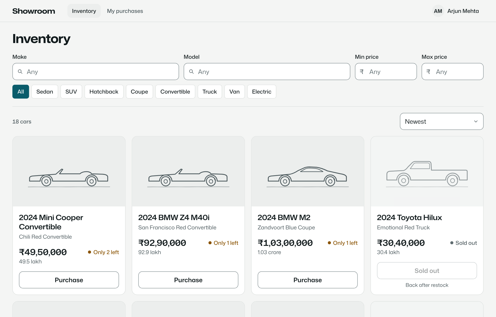

**Contents:** [Features](#features) · [Screenshots](#screenshots) · [Engineering highlights](#engineering-highlights) ·
[Tech stack](#tech-stack) · [Run it locally](#run-it-locally) · [Tests](#tests) · [API](#api) ·
[Project structure](#project-structure) · [Research and decisions](#research-and-decisions) ·
[My AI Usage](#my-ai-usage) · [Deployment](#deployment) · [Credits](#credits)

---

## Features

**For shoppers**
- Register and sign in (JWT). Passwords need 15+ characters, following NIST SP 800-63B-4.
- Browse every car, including sold-out ones, with price in ₹ (Indian digit grouping, plus "12.5 lakh").
- Search by make and model, filter by category and price range, sort by newest, price or year.
  Filters live in the URL, so a filtered view can be shared or bookmarked.
- Buy one or more units through a confirmation sheet that shows the exact total. The Purchase
  button is disabled when a car is sold out.
- See your purchase history, which keeps the price you paid even if the car is edited or removed later.

**For admins** (the admin account is seeded; nobody can make themselves admin)
- Add a car, edit its details, restock it, or delete it after a specific confirmation.
- Stock only changes through purchases and restocks, so every change has a cause.

**Everywhere**
- Mobile-first layout with a bottom tab bar and a price sheet on phones; light and dark mode follow the OS.
- Accessible: visible labels, keyboard-friendly sheets and menus, WCAG-checked colours, reduced-motion support.

## Screenshots

| | |
|---|---|
| 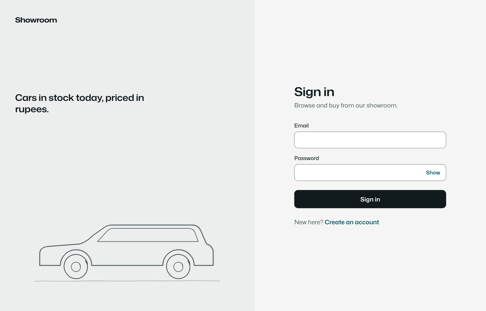 | 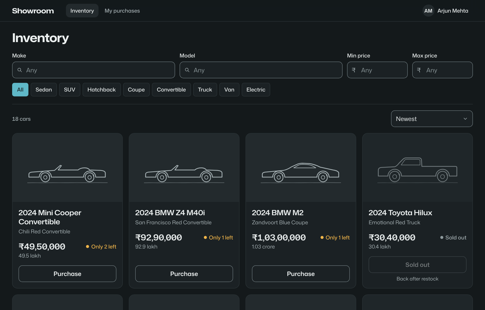 |
| Sign in | Inventory in dark mode |
| 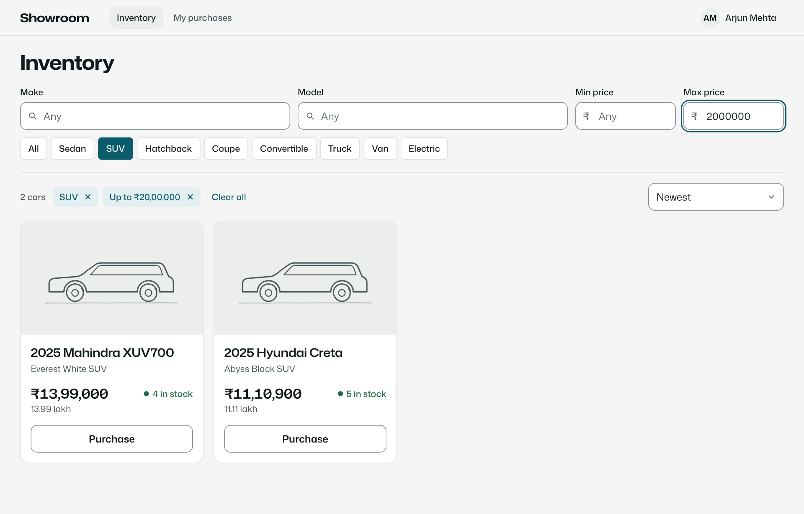 | 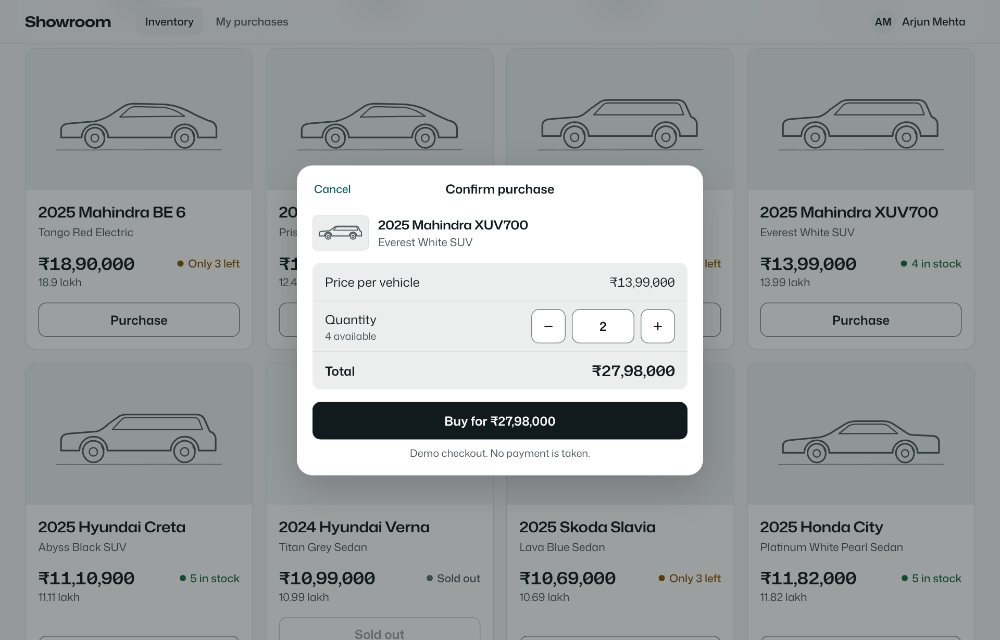 |
| Filters with removable chips and a result count | Purchase confirmation with quantity and total |
| 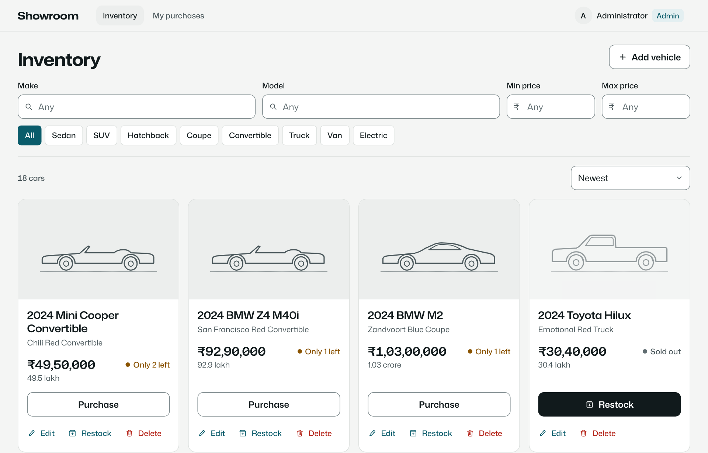 | 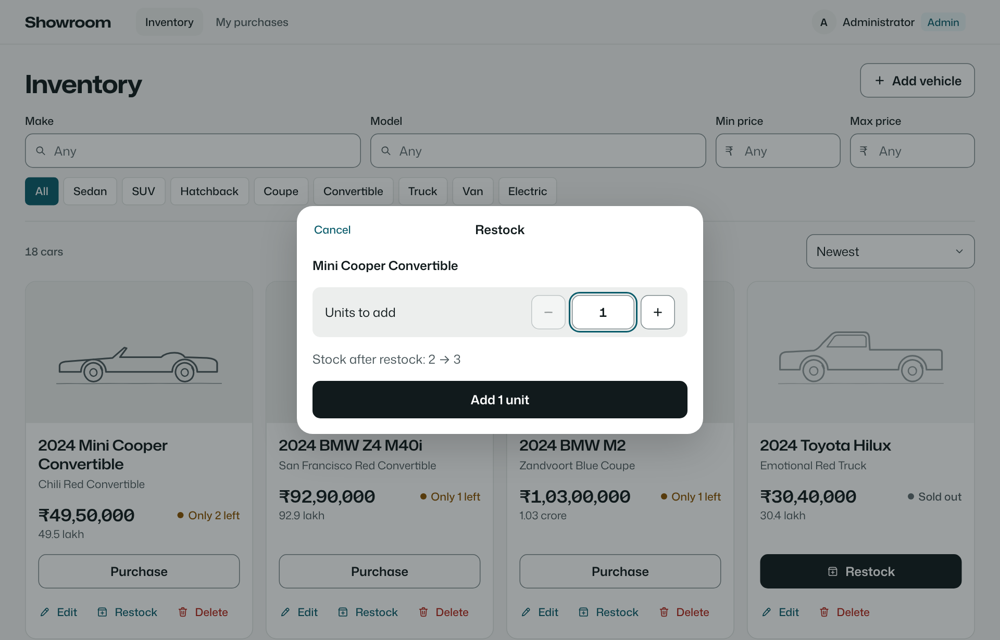 |
| Admin view: Edit, Restock, Delete on every card | Restock with a before → after preview |
| 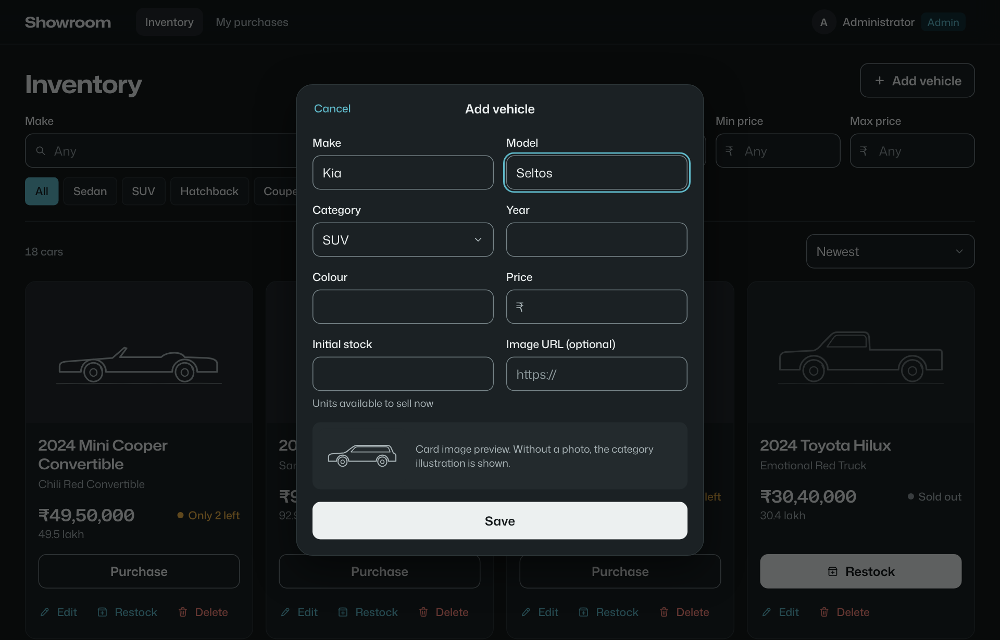 | 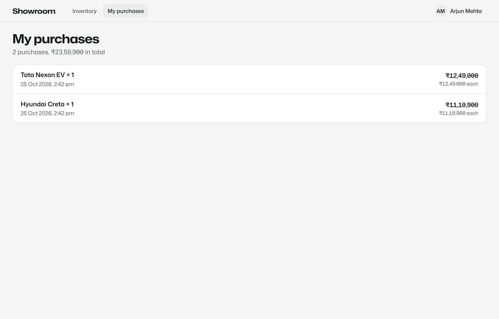 |
| Add vehicle (dark mode) | Purchase history |

| Mobile | | | |
|---|---|---|---|
| 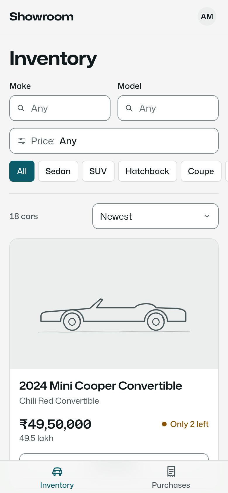 | 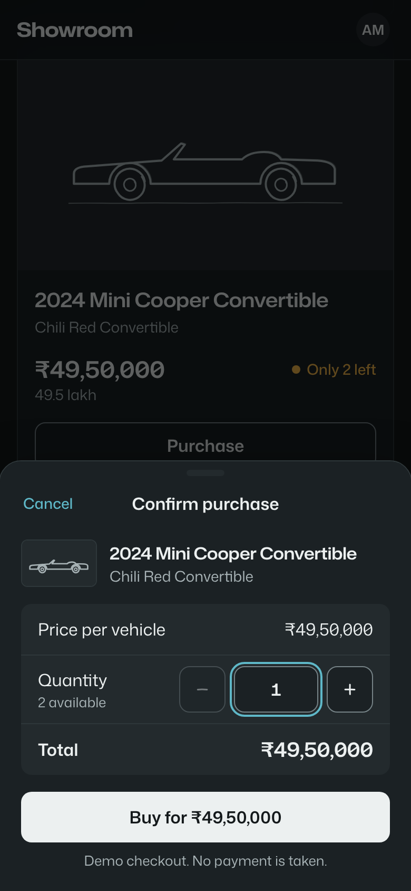 | 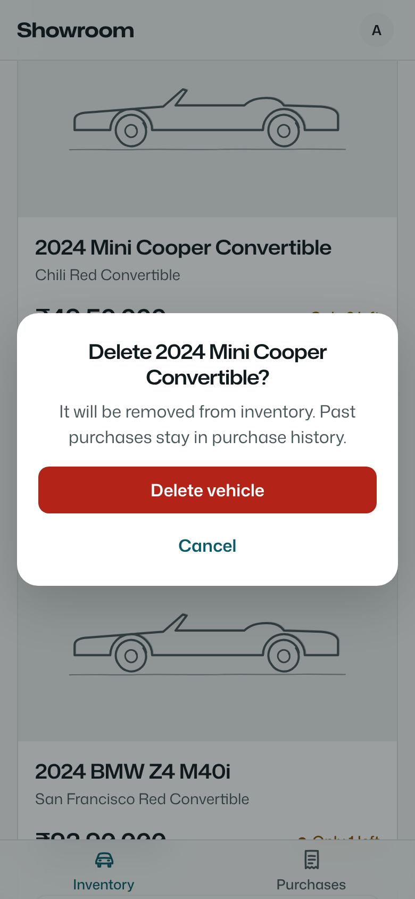 | 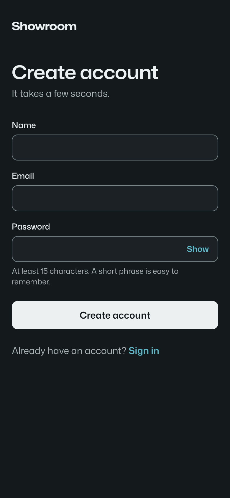 |

Screenshots are captured from the running app with `node scripts/screenshots.cjs` (Playwright).

## Engineering highlights

- **No overselling, proven.** A purchase is one conditional `UPDATE … WHERE quantity >= n` inside a
  transaction, plus a database `CHECK (quantity >= 0)`. A test fires five simultaneous purchases at
  the last car and expects exactly one sale. To prove the test can fail, it was run against a naive
  read-then-write version, which oversold.
- **Security by default.**
  - Passwords are hashed with bcrypt. JWTs are verified with the algorithm pinned to HS256.
  - Every request re-reads the user's role from the database, so a demoted or deleted user loses access immediately.
  - Login and registration are rate-limited.
  - Login uses one generic error and constant-time checks, so it doesn't reveal which emails exist.
  - Search escapes SQL `LIKE` wildcards. Image URLs must be `http(s)`, which blocks `javascript:` links.
  - Errors return a generic 500 with no stack traces.
- **Test-first, with history to show it.** Every feature and every bug found in review went red →
  green in separate commits. 171 backend tests (99% statements) run against a real PostgreSQL
  database; 131 frontend tests (98% statements) drive the whole app through a mocked API.
- **Decisions are written down.** 37 decisions (D1–D37), each with its reasoning, from "how does
  someone become admin?" to "why a hand-drawn icon set?".
- **Research before screens.** User and market research, UX and accessibility guidance, and a visual
  identity study were done before building the UI, and they changed the product (see below).
- **Audited.** A code review found 10 issues: two security gaps and eight bugs. Each was reproduced
  with a failing test, then fixed. A security review found no remaining high or medium issues.

## Tech stack

| Layer | Choice |
|-------|--------|
| Backend | Node.js 22, TypeScript 5.9, Express 5, Prisma 6 (PostgreSQL 16), zod 4, bcryptjs, jsonwebtoken, helmet, express-rate-limit |
| Frontend | React 19, Vite 7, TypeScript 5.9, Tailwind CSS 4, React Router 7, TanStack Query 5, react-hook-form + zod, sonner |
| Tests | Jest 30 + Supertest (backend), Vitest 4 + React Testing Library + MSW (frontend), Playwright (end-to-end tests and screenshots) |
| Design | Mona Sans (SIL OFL), original hand-drawn icons and car drawings, WCAG-checked colour tokens |
| Tooling | ESLint (incl. jsx-a11y), Prettier, GitHub Actions CI, Docker Compose for local Postgres |

All dependencies are pinned to releases that were at least two weeks old when added.

## Run it locally

### Prerequisites
- **Node.js 20+** (developed on 22)
- **PostgreSQL 16**, either with Docker (`docker compose up -d` from the repo root, which creates the
  `dealership`, `dealership_test` and `dealership_e2e` databases) or a local install with those
  databases owned by a `dealership` user (password `dealership`).

### 1. Backend (API on http://localhost:4000)

```bash
cd backend
npm install
cp .env.example .env          # defaults match docker-compose.yml
npx prisma migrate deploy     # create the tables
npm run db:seed               # admin account + 18 sample cars
npm run dev
```

### 2. Frontend (app on http://localhost:5173)

```bash
cd frontend
npm install
npm run dev                   # proxies /api to the backend
```

### 3. Sign in

| Account | How |
|---------|-----|
| Admin | `ADMIN_EMAIL` / `ADMIN_PASSWORD` from `backend/.env` (defaults: `admin@dealership.com` / `showroom-admin-2026`) |
| Shopper | Use "Create an account" on the sign-in page |

> Change `JWT_SECRET` and `ADMIN_PASSWORD` before deploying anywhere public.

### Try the brief's requirements in a few minutes
1. Create a shopper account and land on the inventory (F2, F3).
2. Pick a category chip, type a make, set a max price; then sort by price (F4).
3. Buy two units of a car; a sold-out card shows a disabled "Sold out" button (F5).
4. Sign out, sign in as the admin: add a car, edit its price, restock it, delete it (F6).
5. Resize to phone width and switch your OS to dark mode (F7).

## Tests

```bash
cd backend && npm test            # needs the dealership_test database
cd frontend && npm test
npm run verify                    # in either folder: typecheck + lint + tests
npm run test:coverage             # with coverage
```

**End-to-end tests** drive the real app (API, PostgreSQL and the React SPA) in Chromium with
Playwright: a shopper registers, filters, shares a link and buys; sessions and deep links;
an admin adds, edits, restocks and deletes a car. An accessibility suite runs axe-core
(WCAG 2.2 A/AA, including colour contrast) on every main screen in light and dark mode and at
phone width.

```bash
cd e2e && npm install && npx playwright install chromium   # first time only
npx playwright test
```

The suite starts its own API (port 4100) and Vite server (port 5174) on a separate
`dealership_e2e` database. It empties and seeds that database on
every run, and refuses to touch any database whose name doesn't end in `_e2e`. CI runs it as a
third job.

The full results, coverage tables and every test name are in **[docs/TEST_REPORT.md](docs/TEST_REPORT.md)**.

| Suite | Tests | Statements | Branches |
|-------|-------|-----------|----------|
| Backend | 171 passed | 99.2% | 95.2% |
| Frontend | 131 passed | 98.1% | 92.5% |

## API

All endpoints return JSON. Errors always look like `{ "error": { "code", "message", "details?" } }`.
Everything except health, register and login needs `Authorization: Bearer <token>`.

| Method | Path | Who | Notes |
|--------|------|-----|-------|
| GET | `/api/health` | anyone | `{ status: "ok" }` |
| POST | `/api/auth/register` | anyone | `{ name, email, password }` → `201 { token, user }`; 409 if the email is taken |
| POST | `/api/auth/login` | anyone | `{ email, password }` → `{ token, user }`; one generic 401 for any failure |
| GET | `/api/auth/me` | signed in | the current user |
| GET | `/api/vehicles` | signed in | every vehicle, newest first, sold-out included |
| GET | `/api/vehicles/search` | signed in | `?make&model&category&minPrice&maxPrice`, all optional, combined with AND |
| GET | `/api/vehicles/:id` | signed in | one vehicle |
| POST | `/api/vehicles` | admin | create |
| PUT | `/api/vehicles/:id` | admin | update details (stock cannot be changed here) |
| DELETE | `/api/vehicles/:id` | admin | `204`; purchase history keeps a snapshot |
| POST | `/api/vehicles/:id/purchase` | signed in | `{ quantity? }` (default 1); 409 when stock is short |
| POST | `/api/vehicles/:id/restock` | admin | `{ quantity }` |
| GET | `/api/purchases/me` | signed in | your purchases, newest first |

Validation rules, status codes and the data model are in [docs/DESIGN.md](docs/DESIGN.md).

### Environment variables (backend)

| Variable | Default | Purpose |
|----------|---------|---------|
| `DATABASE_URL` | local `dealership` DB | PostgreSQL connection string |
| `JWT_SECRET` | – (required, 32+ chars) | Token signing secret |
| `JWT_EXPIRES_IN` | `1d` | Token lifetime; needs a unit (`15m`, `12h`, `1d`) |
| `CORS_ORIGIN` | `http://localhost:5173` | Comma-separated allowed frontend origins |
| `ADMIN_EMAIL`, `ADMIN_PASSWORD` | see `.env.example` | Seeded admin account |
| `AUTH_RATE_LIMIT_MAX`, `AUTH_RATE_LIMIT_WINDOW_MINUTES` | `10`, `15` | Login/registration rate limit per IP |
| `TRUST_PROXY` | `0` | Number of proxies in front of the API (1 on Render) |
| `PORT` | `4000` | API port |

Frontend: `VITE_API_URL`, the API's URL in production (leave empty locally; Vite proxies `/api`).

## Project structure

```
backend/
  prisma/              schema, migrations, seed entry
  src/
    app.ts             createApp(): middleware, routes, error handling (no listen → testable)
    config/env.ts      zod-validated environment
    middleware/        requireAuth, requireRole, validate, rateLimit, errorHandler
    modules/           auth, vehicles, inventory (purchase, restock, history)
    lib/ errors/ seed/
  tests/               integration (Supertest + real DB) and unit tests
frontend/
  src/
    components/        UI primitives, icons (hand-drawn), layout (shell, menu, tab bar)
    features/          auth, inventory (cards, filters, purchase, admin sheets), purchases
    lib/               API client, formatting (₹, lakh), filters, stock rules
    test/              MSW server, fixtures, render helpers
docs/                  workflow, requirements + decision log, design, research, test report, screenshots
scripts/               screenshot capture, PROMPTS.md export
```

## Research and decisions

The project was planned before it was built, and the planning is part of the submission:

| Document | What it shows |
|----------|---------------|
| [docs/WORKFLOW.md](docs/WORKFLOW.md) | The phase plan with a review checkpoint after every phase |
| [docs/REQUIREMENTS.md](docs/REQUIREMENTS.md) | Every line of the brief traced to code and tests, plus decisions D1–D37 with reasoning |
| [docs/DESIGN.md](docs/DESIGN.md) | Architecture, data model, API contract, validation rules, testing strategy |
| [docs/research/](docs/research/README.md) | User and market research (Indian car buyers, dealers), UX patterns (Baymard, NN/g), accessibility, NIST password guidance, TDD and AI evidence, visual identity study |
| [docs/TEST_REPORT.md](docs/TEST_REPORT.md) | Test results and coverage |
| [docs/INTERVIEW_NOTES.md](docs/INTERVIEW_NOTES.md) | Demo script, key decisions and likely interview questions |

Research changed the product in concrete ways:
- **NIST SP 800-63B-4** led to the 15-character password minimum and the login rate limiting.
- **Baymard and NN/g** shaped the filter chips, the result count, URL-synced filters and the purchase confirmation.
- **Mobile traffic in India** (mostly phones) led to the bottom tab bar and the price sheet on phones.
- **The visual identity study** replaced default-looking UI with a deliberate typeface, colour and shape system.

## My AI Usage

**Tools.** I built this project with **Claude Code**, Anthropic's coding agent, in a cloud session
connected to this repository. Inside Claude Code I used:
- background research agents for the user/market and visual-identity research;
- the `code-review` and `security-review` skills for the audit;
- the `session-start-hook` skill to make the dev environment reproducible;
- Playwright, through the agent, for screenshots.

**How I used it.**
- **Planning:** turned the brief into a phased workflow with checkpoints, a requirements matrix
  and a decision log. The agent asked me a question at each checkpoint (stack, database, how
  admins are created, purchase rules, currency, deployment, visual direction) and I made each call.
- **Research:** I asked for user-centric research before any screen was built, and later for
  research on why the first UI looked AI-generated. Both reports cite their sources. The agent
  re-checked key facts itself, such as contrast ratios and the NIST wording.
- **Implementation:** the agent wrote the tests and the code in red → green steps. Every
  AI-assisted commit has a `Co-authored-by: Claude <noreply@anthropic.com>` trailer and a
  factual "AI assistance:" line.
- **Review:** at three milestones I reviewed real screenshots and asked for changes:
  - a less "AI-made" look;
  - original hand-drawn icons instead of a library set;
  - monochrome line-art cars that work in dark mode.
  The agent ran a code review and a security review and fixed the findings test-first.
- **Documentation:** this README, the test report and the docs were drafted by the agent from the
  real test output and the decision log.

**Reflection.**
- **It made the process faster and more rigorous.** It was much faster than working alone, and it
  pushed for more rigour than I would have applied by myself: every ambiguity in the brief became
  a recorded decision, every bug got a test, and the concurrency test was itself checked to make
  sure it could fail.
- **It needed supervision.** Mistakes it made and then caught or owned up to:
  - it wrote commit messages claiming reviews I hadn't done (corrected before anything was reviewed);
  - it pushed a test that failed because it assumed an order (fixed, and commits are now gated
    on the full test suite);
  - a mechanical rename left the filter chips with the wrong border and a dark-mode contrast bug,
    which I only caught by looking at screenshots.
- **Research agrees with that experience.** The engineering evidence I collected is mixed: AI
  helps with small, well-specified tasks but can slow experienced developers down
  (`docs/research/05-engineering-evidence.md`). Fast feedback loops made the difference: tests,
  CI, screenshots and a checkpoint with me after every phase.
- **What I'd do differently:** decide on the visual identity before building the first screens.
  The first UI looked generic precisely because I hadn't given direction yet.

The complete conversation is in **[PROMPTS.md](PROMPTS.md)**, exported word for word from the
session transcript by `scripts/export_prompts.py`.

## Deployment

**Live demo:** **[car-dealership-inventory-system-gold.vercel.app](https://car-dealership-inventory-system-gold.vercel.app)**. Register any account to shop (passwords need 15+ characters). Admin access is available on request, so the public demo
inventory can't be wiped by visitors.

The whole app deploys as **one Vercel project** using
[Vercel Services](https://vercel.com/docs/services), configured in the root [`vercel.json`](vercel.json):

| Path | Served by |
|------|-----------|
| `/api/*` | `backend` service: the Express app (`backend/server.ts` → `src/app.ts`) as a Vercel Function |
| everything else | `frontend` service: the Vite build. Real files are served first; any other path without a file extension falls back to `index.html`, so the app's router handles it (unknown pages redirect home) |

The frontend calls `/api` on its own origin, so there is no CORS setup and no API URL to configure.
On every deployment the backend's build step (`backend/scripts/vercel-build.sh`) applies the Prisma
migrations and runs the seed. The seed is safe to repeat: it only creates the admin and sample cars
if they are missing.

### One-time setup in the Vercel dashboard

1. **Import the repository** with *Root Directory* left at the repository root. Vercel reads
   `vercel.json` and detects the two services.
2. **Add a database.** *Storage → Create Database → Neon (Postgres)*, then connect it to the
   project for all environments. This sets `DATABASE_URL` (pooled, used at runtime) and
   `DATABASE_URL_UNPOOLED` (direct, used for migrations).
3. **Add environment variables** (*Settings → Environment Variables*). Tick **Production and
   Preview** for each one: pull-request builds are Preview builds, and the seed fails without
   the admin variables.

   | Name | Value |
   |------|-------|
   | `JWT_SECRET` | a long random string, e.g. the output of `openssl rand -hex 32` |
   | `ADMIN_EMAIL` | the admin's email |
   | `ADMIN_PASSWORD` | 15+ characters, **not** the default from `.env.example` (production refuses it) |
   | `TRUST_PROXY` | `1` (so rate limiting sees the real client IP behind Vercel's proxy) |

4. **Redeploy** (*Deployments → … → Redeploy*). The build log shows the migrations and
   "Admin account ready".

Locally, `vercel dev -L` runs the same two-service setup on one port.

## Known limitations and next steps
- No pagination: fine for a showroom-sized inventory, needed for thousands of cars.
- The JWT lives in `localStorage` (a documented trade-off in DESIGN §5); an httpOnly cookie
  would be safer if the app grew.
- Rate-limit counters are in memory per instance. On serverless, or with several API instances,
  a shared store such as Redis would make the limits exact.
- Purchases are a demo checkout with no payment step. An idempotency key on purchase would be the
  next step for real payments.

## Credits
- **Mona Sans** by GitHub with Degarism, SIL Open Font License 1.1, self-hosted via Fontsource.
- **Icons and car drawings** are original artwork made for this project (no icon library).
- Sample prices are approximate ex-showroom figures for demonstration only.
- Licensed under the [MIT License](LICENSE).
